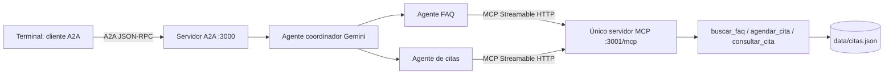

# Hoja de trabajo 7 — Protocolos Agénticos

CC3116 · Universidad del Valle de Guatemala · Parachute S.A.

Implementación en JavaScript basada en [hoja6-ia](https://github.com/Diana-Sosa18/hoja6-ia), que ya utilizaba Gemini. Se conservan sus preguntas frecuentes, reglas de citas y nombres de herramientas. [Procedencia y cambios](docs/ORIGEN.md).



## Instalación

Requiere Node.js 22 o superior. Desde la raíz del repositorio:

```powershell
npm ci
Copy-Item .env.example .env
```

Para el sistema multiagente normal, completa `GOOGLE_API_KEY` en `.env`. El modelo original se conserva como valor predeterminado; `AGENT_MODEL` permite usar otro modelo de Gemini disponible en tu cuenta. No se necesita una clave de OpenAI.

Abre **tres terminales** en la raíz del proyecto:

```powershell
# Terminal 1: herramientas
npm run mcp
```

```powershell
# Terminal 2: sistema multiagente expuesto como un solo agente
npm run a2a
```

```powershell
# Terminal 3: cliente A2A interactivo
npm run client
```

Ejemplos en el cliente:

```text
¿Cuánto cuesta la consulta?
Quiero agendar una cita.
Mi nombre es Ana Pérez, el 2 de noviembre de 2026 a las 10:00 y mi correo es ana@example.com.
Consulta la cita APT_0001.
¿Cuál es la ubicación y puedes agendar otra cita para Luis el 3 de noviembre de 2026 a las 11:00, luis@example.com?
/nuevo
/salir
```

Los IDs dependen de las reservas existentes. La conversación mantiene su `contextId`; `/nuevo` crea otra conversación. También puedes enviar un solo mensaje: `npm run client -- "¿Cuál es el horario?"`.

## Prueba sin credenciales

En la **terminal 2**, establece el modo antes de arrancar A2A:

```powershell
$env:AGENT_MODE="demo"
npm run a2a
```

Este modo determinista prueba los servidores y protocolos reales, pero **no ejecuta Gemini ni demuestra razonamiento multiagente**. Acepta estos mensajes en la terminal 3:

```text
/faq ¿Cuál es el horario de atención?
/agendar {"nombre":"Ana Prueba","fecha":"2026-11-02","hora":"10:00","correo":"ana@example.com"}
/consultar APT_0001
/salir
```

Para volver a Gemini, termina el servidor, ejecuta `Remove-Item Env:AGENT_MODE` y reinícialo con `AGENT_MODE=gemini` en `.env`.

## Cómo cumple la hoja

| Requisito | Implementación |
| --- | --- |
| Un servidor MCP | `src/mcp-server.js`; registra las tres herramientas originales |
| Streamable HTTP | Transporte oficial `StreamableHTTPServerTransport`, endpoint `/mcp` |
| Prompts y recursos MCP | Prompt `atencion_cliente`; recurso `parachute://politicas` |
| Multi agent system | `src/multi-agent.js`; coordinador Gemini que delega en FAQ y citas, cada uno con sus instrucciones y herramientas permitidas |
| Un agente A2A con skills | `src/a2a-server.js`; Agent Card con FAQ, agendar y consultar |
| Terminal como cliente A2A | `src/cli.js` y `src/a2a-client.js`; descubrimiento y mensajes mediante el SDK oficial |
| Logs | JSON por herramienta (`tool.start`, `tool.end`, `tool.error`), delegación y estado A2A |
| Video | [MP4 del modo demo](docs/evidencia/demo-protocolos.mp4) y [guion para grabar con Gemini](docs/VIDEO.md) |

La terminal solo importa el cliente A2A. Los agentes descubren las herramientas mediante `listTools` y las invocan mediante `callTool`; no importan las implementaciones de negocio. MCP publica además un prompt y un recurso que se pueden inspeccionar, aunque los agentes usan instrucciones propias.

## Endpoints y pruebas

- MCP: `http://127.0.0.1:3001/mcp`
- Agent Card: `http://127.0.0.1:3000/.well-known/agent-card.json`
- A2A JSON-RPC: `http://127.0.0.1:3000/`
- Salud: `/health` en ambos servidores.

```powershell
npm test
```

La prueba inicia procesos reales en puertos 13000/13001 y una base temporal. Verifica descubrimiento, las tres herramientas, prompts, recursos, tareas consultables, streaming, colisiones de horario, fechas inválidas, fines de semana, horario, argumentos incompletos, persistencia y falla de MCP. También verifica el ciclo coordinador → especialista FAQ → MCP usando respuestas controladas del modelo. No consume API ni modifica las citas de la demostración; las llamadas reales a Gemini requieren una clave y una comprobación adicional.

Las evaluaciones de la hoja 6 se conservan en `promptfooconfig.yaml`, adaptando `provider.js` para usar A2A y sus metadatos. Para ejecutarlas instala opcionalmente `npm install --save-dev promptfoo@0.123.1`, arranca ambos servidores **en modo Gemini**, configura también las credenciales del evaluador de promptfoo y ejecuta `npm run eval`. No se incluyen reportes antiguos como evidencia de esta implementación.

## Alcance

Citas persistidas por un único proceso MCP; conversaciones y tareas A2A en memoria. Las citas admiten lunes a viernes de 09:00 a 17:00 y los datos de negocio provienen de la hoja 6. Reiniciar A2A reinicia la memoria conversacional, pero no borra citas. No se envían correos. El servidor es para demostración local en loopback, sin autenticación. Los artefactos A2A incluyen metadatos de herramientas para las evaluaciones; utiliza datos ficticios al grabar.

## Referencias

- [Construir servidor MCP](https://modelcontextprotocol.io/docs/2026-07-28/develop/build-server)
- [SDK oficial de MCP para TypeScript/JavaScript](https://github.com/modelcontextprotocol/typescript-sdk)
- [Protocolo A2A](https://a2a-protocol.org/latest/)
- [SDK oficial A2A para JavaScript](https://github.com/a2aproject/a2a-js)
- [SDK de Gemini](https://googleapis.github.io/js-genai/release_docs/index.html)

Se usa A2A 1.0 mediante `@a2a-js/sdk` 1.3.0; algunos tutoriales antiguos muestran formatos A2A 0.3 que difieren de esta implementación. Las versiones de SDK se fijan en `package.json` y `package-lock.json`.
